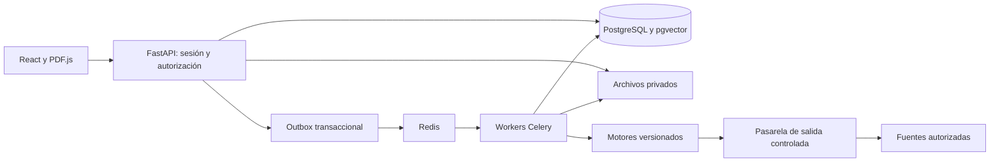

# Arquitectura

## Estado al cierre de Fase 1

Fase 1 implementada en `backend/app` (auth, institutions, db, security, worker) y `frontend/src/pages`/`components`. Las fronteras y motores de este diseño se ampliarán por fases; el outbox genérico aún es diseño, mientras la cola durable de correo ya funciona. Ver [Fase 1](docs/PHASE_1.md).

## Decisión base de Fase 0

Monolito modular Python con API FastAPI y workers Celery separados como procesos. SPA React/TypeScript. PostgreSQL es la fuente de verdad; pgvector alberga embeddings; Redis es un intermediario de tareas, nunca el único registro de trabajo. Archivos privados en volumen local de desarrollo y almacenamiento compatible S3 en producción. Esta es la arquitectura adoptada; las versiones finales, capacidad y umbrales dependerán de la validación de Fase 1 y de las evaluaciones posteriores.



## Módulos y fronteras

Identidad controla instituciones, sesiones, membresías y permisos. Documentos controla originales inmutables, extracción y mapas. Auditorías orquesta ejecuciones. Motores producen candidatos y evidencias; no deciden sanciones. Casos almacena decisiones humanas. Informes genera versiones reproducibles. Integraciones controla Moodle, proveedores y webhooks. Cada módulo accede mediante servicios explícitos; no importa entidades internas de otro módulo para eludir autorización.

## Flujo durable

1. API autentica y autoriza, reserva cuota y recibe archivo mediante streaming limitado.
2. Almacena original en cuarentena, calcula SHA-256 y crea Document, Version y Job junto con outbox en una transacción.
3. Despachador publica identificador del job; worker adquiere lease, valida y extrae bajo límites.
4. Guarda fragmentos y mapa versionado. Cada motor registra alcance, versión, parámetros, tiempos y resultados parciales.
5. Consolida evidencias, calcula métricas de cobertura y publica evento de terminación. La UI consulta progreso real.

Entrega al menos una vez: unicidad por job/etapa/versión del motor, escrituras transaccionales y reintentos idempotentes. No prometer ejecución exactamente una vez. Lease con heartbeat y recuperación de trabajos huérfanos; reintentos acotados con backoff solo para errores transitorios. Errores de validación no se reintentan. Cancelación cooperativa entre etapas. PostgreSQL conserva estado después de perder Redis; reconciliador recupera outbox y jobs interrumpidos.

## Estados y cobertura

Documento: recibido → validando → extrayendo → disponible, fallido o cancelado. Auditoría: pendiente → analizando → completado, parcial, fallido o cancelado. Cada motor tiene estado independiente: pendiente, ejecutando, completado, no_disponible, fallido, cancelado. Un análisis parcial nunca se etiqueta exhaustivo. El progreso usa etapas y unidades procesadas; no porcentajes inventados.

## Estructura prevista

```text
backend/
  app/
    api/v1/           # transporte y dependencias de autorización
    core/             # configuración, seguridad y logging
    modules/
      identity/ documents/ audits/ findings/ sources/
      references/ cases/ rubrics/ reports/ integrations/
    engines/          # contratos y adaptadores reemplazables
    workers/          # jobs, leases, outbox, reconciliación
    storage/          # objetos privados y snapshots
  migrations/
  tests/unit/ tests/integration/ tests/security/
frontend/
  src/app/ src/features/ src/components/ src/lib/
  tests/
infra/                # Compose, imágenes, monitorización
scripts/              # administración y copias
models/               # manifiestos; pesos fuera de Git
evaluation/           # datasets autorizados y protocolos
docs/                 # documentación y decisiones
```

Los directorios de aplicación son un diseño, aún no se crean implementaciones vacías. Datasets, pesos y documentos privados no se versionarán. Configuración por entorno con validación al arrancar; secretos fuera del repositorio. OpenAPI genera tipos del cliente en CI para impedir divergencias.

## Consistencia y rendimiento

Paginación por cursor y tenant; procesamiento por lotes de fragmentos. Índices vectoriales con filtrado de institución obligatorio. Evaluar recall con filtros antes de escoger HNSW. Si el índice aproximado reduce cobertura, recuperar candidatos con búsqueda exacta acotada. Concurrencia de workers basada en memoria y límites reales, no en todos los núcleos por defecto. Separar colas de extracción, red e inferencia sin convertir módulos en microservicios.
